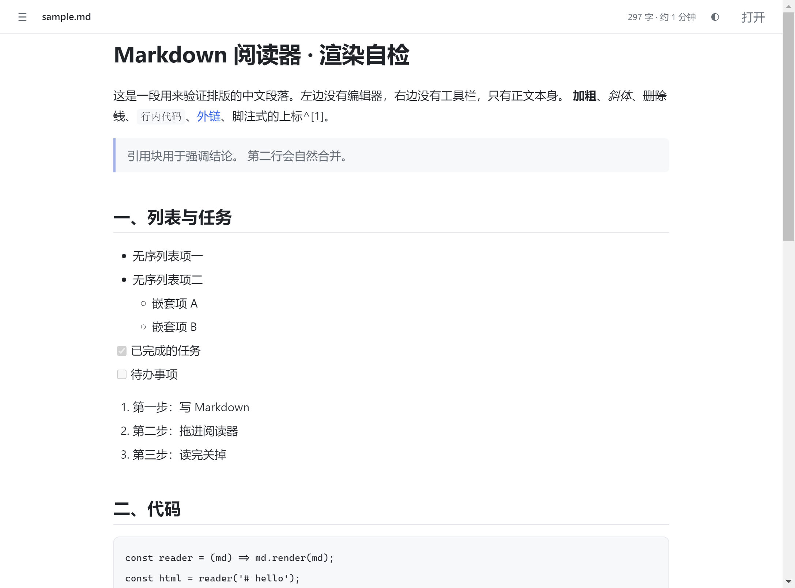

# MD Reader

**A 7 MB Markdown reader for Windows.** Double-click a `.md` file and it opens. No installer, no background process.

**English** · [中文](README.md)



## Download

Grab `MD Reader.exe` from [Releases](../../releases/latest). It is portable — put it anywhere, no install needed.

| File | Size | What it is |
| --- | --- | --- |
| `MD Reader.exe` | **7.3 MB** | Standalone window, can be set as the default app for `.md` |
| `MD Reader.html` | **118 KB** | Single file, open in a browser and drop a file in |

## Why only 7 MB

It does not bundle a browser engine. Rendering is handed to the Edge that already ships with Windows
(or Chrome, if Edge is missing), launched in `--app` mode: a window with no address bar, no tabs,
and its own taskbar icon.

A comparable Electron app weighs 250 MB, and 99% of that is Chromium. This one carries none of it.
The app code is 30 KB; the remaining 7 MB is the Python launcher runtime — the smallest thing
achievable without a C compiler on hand.

**The trade-off**: the window process belongs to Edge (Alt+Tab shows the Edge icon), and memory
usage is Edge's too.

## Features

- Full CommonMark + GFM: tables, task lists, strikethrough, autolinks, fenced code
- Raw HTML rendered as-is (`html: true`) — most exported Markdown just works
- Typography tuned for Chinese text: paragraph spacing, line height, CJK/Latin mixing
- Relative image paths resolved against the document's own folder
- Encoding detection: UTF-8 first, GBK fallback
- Auto table of contents (2+ headings), reading progress bar, copy button on code blocks
- Light / dark / follow system
- Print stylesheet included (Ctrl+P gives you a clean PDF)

## Usage

```
MD Reader.exe some-document.md    open that file
MD Reader.exe                     open an empty page, drop a file in
```

Set as default: right-click any `.md` → Open with → Choose another app → pick `MD Reader.exe` →
check "Always use this app".

All registry entries live under `HKCU`, no admin rights required. See "Default app" below to undo.

## Shortcuts

| Key | Action |
| --- | --- |
| `Ctrl+O` | Open a file |
| `T` | Toggle table of contents |
| `D` | Cycle theme |

## Build it yourself

```bash
# single-file HTML (needs Node)
npm install
node build.js

# the exe (needs Python + PyInstaller)
pip install pyinstaller
python -m PyInstaller --onefile --noconsole --name "MD Reader" ^
  --icon assets/icon.ico ^
  --add-data "dist/MD Reader.html;." --distpath dist-small launcher.py
```

## Layout

```
src/template.html   the reader itself: CSS, rendering logic, interactions
build.js            inlines markdown-it + favicon → dist/MD Reader.html
launcher.py         reads the .md, writes the page, hands it to Edge --app
assets/             icons
docs/               screenshots
```

## Default app

Registered under `HKCU\Software\Classes`:

| Key | Purpose |
| --- | --- |
| `MDReader.md` | ProgID: icon + `"exe" "%1"` |
| `.md` default value | points to `MDReader.md` |
| `.md\OpenWithProgids` | makes it show up in "Open with" |
| `Applications\MD Reader.exe` | app manifest |

To undo: delete the `MDReader.md` key and clear the default value of `.md`.

## Limitations

- No math or footnote rendering (`$...$` and `[^1]` are shown literally)
- Requires Edge or Chrome; without either it falls back to the default browser (window has an address bar)
- The exe is unsigned, so the first launch may hit SmartScreen — click "More info → Run anyway"

## License

MIT
