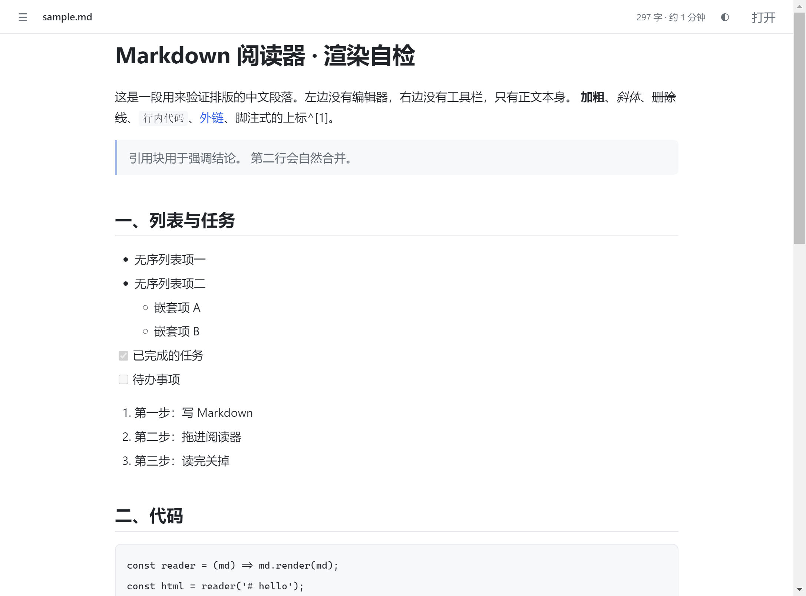

# MD Reader

**一个 7 MB 的 Markdown 阅读器。** 双击 `.md` 就开，没有安装包，没有后台进程。

[English](README.en.md) · **中文**



## 下载

去 [Releases](../../releases/latest) 拿 `MD.Reader.exe`，放哪儿都能跑，不需要安装。
（GitHub 会把附件名里的空格变成点，本地叫 `MD Reader.exe`，是同一个文件。）

| 文件 | 体积 | 说明 |
| --- | --- | --- |
| `MD.Reader.exe` | **7.3 MB** | 独立窗口，可设为 `.md` 的默认打开方式 |
| `MD.Reader.html` | **118 KB** | 单文件，浏览器打开，拖文件进去 |

## 为什么只有 7 MB

因为它不打包浏览器内核。渲染交给系统自带的 Edge（没有就找 Chrome），用 `--app` 模式
开一个无地址栏、无标签页、独立任务栏图标的窗口。

Electron 版的同类工具要 250 MB，其中 99% 是 Chromium。这里一个字节都不带。
应用代码本身 30 KB，剩下 7 MB 是 Python 运行时的启动器——这是在不装编译器的前提下
能做到的最小体积。

**代价**：窗口进程属于 Edge，Alt+Tab 里显示 Edge 图标；内存也走 Edge。

## 能做什么

- CommonMark 全量 + GFM：表格、任务列表、删除线、自动链接、围栏代码块
- 原始 HTML 直接渲染（`html: true`），导出工具生成的 md 基本都能正确显示
- 中文排版：段距、行高、中英混排间距按阅读习惯调整
- 相对路径图片自动按文档所在目录解析
- 编码自动识别：UTF-8 优先，失败回落 GBK
- 目录侧边栏（标题 ≥2 个自动出现）、阅读进度条、代码块一键复制
- 浅色 / 深色 / 跟随系统
- 打印样式适配（Ctrl+P 直接出干净 PDF）

## 用法

```
MD.Reader.exe 某文档.md      直接看这篇
MD.Reader.exe                打开空白页，拖文件进去
```

设成默认：右键任意 `.md` → 打开方式 → 选择其他应用 → 找到 `MD.Reader.exe` → 勾「始终」。

注册表项写在 `HKCU`，不需要管理员；撤销方法见下方「默认程序」。

## 快捷键

| 键 | 功能 |
| --- | --- |
| `Ctrl+O` | 打开文件 |
| `T` | 显示 / 隐藏目录 |
| `D` | 切换主题 |

## 自己构建

```bash
# 单文件 HTML（需要 Node）
npm install
node build.js

# 打包 exe（需要 Python + PyInstaller）
pip install pyinstaller
python -m PyInstaller --onefile --noconsole --name "MD Reader" ^
  --icon assets/icon.ico ^
  --add-data "dist/MD Reader.html;." --distpath dist-small launcher.py
```

## 结构

```
src/template.html   阅读器本体：排版 CSS + 渲染逻辑 + 交互
build.js            把 markdown-it 和 favicon 内联进去 → dist/MD Reader.html
launcher.py         读 .md → 生成页面 → 交给 Edge --app
assets/             图标
docs/               截图
```

## 默认程序

在 `HKCU\Software\Classes` 下注册：

| 键 | 作用 |
| --- | --- |
| `MDReader.md` | ProgID：图标 + `"exe" "%1"` |
| `.md` 默认值 | 指向 `MDReader.md` |
| `.md\OpenWithProgids` | 让它出现在「打开方式」列表 |
| `Applications\MD Reader.exe` | 应用清单 |

撤销：删掉 `MDReader.md` 键，再把 `.md` 的默认值清空。

## 局限

- 不渲染数学公式和脚注（`$...$`、`[^1]` 按原文显示）
- 依赖系统里的 Edge 或 Chrome；两者都没有会退回默认浏览器（窗口带地址栏）
- exe 没有代码签名，第一次运行 Windows 可能弹 SmartScreen，点「更多信息 → 仍要运行」

## 许可

MIT
